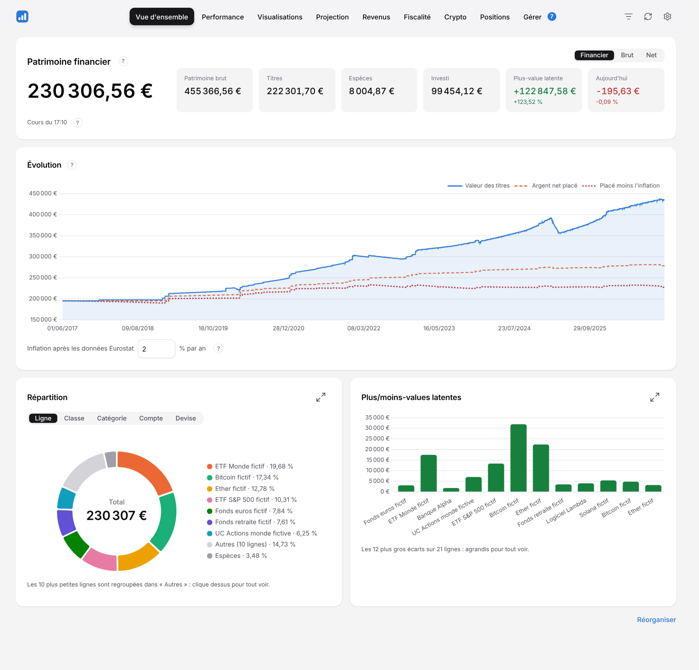

# Patrimoine

**Patrimoine est un logiciel libre et gratuit de suivi de patrimoine financier, 100 % local et en
lecture seule** : actions et ETF, crypto, assurance-vie, PER, livrets, immobilier, et tout ce qui
n'a pas de cours public (valeur saisie à la main). Alternative privée aux agrégateurs en ligne :
sans compte, sans abonnement, sans cloud, vos données restent sur votre ordinateur, comme un coffre
KeePass. Pour Windows, macOS et Linux, en français.


- **Lecture seule** : Patrimoine ne passe aucun ordre et ne se connecte à aucune banque, aucun
  courtier, aucune plateforme. Vous saisissez ou importez (CSV) vos opérations.
- **Local** : une base SQLite dans votre dossier utilisateur. Aucun montant, aucune quantité,
  aucune adresse de portefeuille ne quitte la machine ; l'app n'a ni télémétrie ni statistiques
  d'usage.
- **Code ouvert** : sous licence GNU GPL v3 ou ultérieure. Vous pouvez lire ce que fait l'app.

## Avertissement

**Patrimoine n'est pas un conseil en investissement, ni un conseil fiscal.** Les performances,
impôts, plafonds et projections affichés sont des **estimations** calculées à partir de ce que
vous avez saisi et de cours publics qui peuvent être faux ou en retard. Ils ne remplacent ni vos
relevés, ni votre déclaration de revenus, ni l'avis d'un professionnel. Les repères fiscaux
suivent les règles françaises connues à la date de la version et peuvent devenir faux quand la loi
change.

Le logiciel est fourni **sans aucune garantie** (articles 15 et 16 de la licence) : une erreur de
calcul ou une perte de données reste possible. Les versions 0.x sont jeunes. Gardez des
sauvegardes ailleurs que sur le disque de l'ordinateur.

Le code facultatif d'un profil protège de la curiosité dans l'app, **pas** de la lecture du fichier
de la base, qui n'est pas chiffré pour l'instant.

## Installer sous Windows

1. Sur la page [Releases](../../releases/latest), télécharger `Patrimoine-X.Y.Z-windows.zip`.
2. Facultatif mais conseillé : vérifier l'empreinte du fichier (PowerShell) et la comparer à la
   ligne du même nom dans `SHA256SUMS.txt`.
   ```powershell
   Get-FileHash .\Patrimoine-X.Y.Z-windows.zip -Algorithm SHA256
   ```
3. Clic droit > **Extraire tout**, puis lancer `Patrimoine.exe` dans le dossier extrait.
   Rien à installer, aucun droit d'administrateur.

L'exécutable n'est pas encore signé : Windows peut afficher « Windows a protégé votre ordinateur ».
Cliquer sur **Informations complémentaires** puis **Exécuter quand même**, après avoir vérifié
l'empreinte si vous voulez être sûr du fichier.

**Mettre à jour** : télécharger la nouvelle version, l'extraire, et remplacer l'ancien dossier.
Vos données ne sont jamais dans ce dossier : la nouvelle version les retrouve et, si besoin, met la
base à jour après en avoir fait une copie.

## Installer sur Mac

Pour un Mac à puce Apple (M1 et suivants). Sur un Mac Intel, lancer l'app depuis le code (plus bas).

1. Sur la page [Releases](../../releases/latest), télécharger `Patrimoine-X.Y.Z-macos.dmg`.
2. Facultatif mais conseillé : vérifier l'empreinte dans le Terminal et la comparer à la ligne du
   même nom dans `SHA256SUMS.txt`.
   ```bash
   shasum -a 256 ~/Downloads/Patrimoine-X.Y.Z-macos.dmg
   ```
3. Ouvrir le `.dmg`, puis glisser **Patrimoine** sur le raccourci **Applications**.
4. Lancer Patrimoine depuis Applications (ou le Launchpad).

**Premier lancement.** L'app n'est pas notarisée par Apple (un compte développeur payant serait
nécessaire) : macOS affiche « Patrimoine » n'a pas été ouvert, Apple n'a pas pu vérifier qu'il ne
contient pas de logiciel malveillant.

1. Cliquer sur **Terminé** (pas sur « Placer dans la corbeille »).
2. Menu  > **Réglages Système** > **Confidentialité et sécurité**, descendre jusqu'à la partie
   **Sécurité** : « Patrimoine » a été bloqué… Cliquer sur **Ouvrir quand même**, confirmer avec
   le mot de passe ou Touch ID, puis **Ouvrir quand même** encore une fois.

C'est à faire une seule fois par version. Si vous êtes à l'aise avec le Terminal, cette commande
fait la même chose (elle retire la marque « téléchargé d'Internet » de l'app) :

```bash
xattr -dr com.apple.quarantine /Applications/Patrimoine.app
```

Si macOS dit que l'app est **endommagée**, ne la lancez pas : le fichier a été abîmé ou modifié en
route. Retéléchargez-le et vérifiez son empreinte.

**Quitter** : Cmd+Q, ou fermer la fenêtre. **Mettre à jour** : glisser la nouvelle version dans
Applications et accepter de remplacer l'ancienne ; vos données restent où elles sont.

## Où sont vos données

| Système | Dossier par défaut |
| --- | --- |
| Windows | `%LOCALAPPDATA%\Patrimoine` |
| macOS | `~/Library/Application Support/Patrimoine` |
| Linux, WSL | `~/.local/share/patrimoine` (ou `$XDG_DATA_HOME/patrimoine`) |

Une base par profil, et une sauvegarde automatique par jour dans `sauvegardes/` (faite au lancement,
revérifiée chaque heure ; gardées 14 jours, puis une par mois sur 12 mois, puis une par an). Ne placez pas ce dossier dans OneDrive ou un autre dossier synchronisé : une base
SQLite copiée pendant l'écriture peut être abîmée. Choisir un autre dossier se fait pour l'instant
depuis le code : `uv run python -m app.datadir --choisir DOSSIER` (copie vérifiée).

## Ce qui sort de votre machine

Seulement des demandes publiques, sans montant ni quantité :

- cours de bourse, et clôtures quotidiennes des cryptos, par ticker (Yahoo Finance) ; cours du
  jour des cryptos par identifiant (CoinGecko) ;
- sur un clic, la recherche du ticker d'un ISIN (Yahoo Finance : l'ISIN, puis le nom public du
  titre trouvé) ;
- taux de change de la BCE (Frankfurter) ;
- indice des prix Eurostat, pour la courbe de l'inflation ;
- taux de dépôt et d'emprunt publics d'Aave, si vous suivez une ligne Aave (une fois par jour) ;
- si vous l'acceptez (question au premier lancement, modifiable dans Réglages), le numéro de la
  dernière version de Patrimoine publiée sur GitHub, une fois par jour. L'app prévient seulement :
  elle ne télécharge ni n'installe rien.

Ces services voient votre adresse IP et le ticker demandé, comme pour toute visite de leur site.
Dans l'app, Réglages (roue dentée) > Aide > « Ce qui sort de cet ordinateur » reprend cette liste
avec le nombre de requêtes depuis le lancement ; toute autre adresse est bloquée par l'app.
L'app n'écoute que sur `127.0.0.1` : elle n'est pas joignable depuis un autre appareil.

Hors de la portée de l'app, sans aucun montant : le moteur de la fenêtre (WebView2 sous Windows)
envoie sa propre télémétrie selon le réglage « Diagnostics » de Windows, et Windows le met à jour.

## Depuis le code (Windows, macOS, Linux)

Prérequis : [uv](https://docs.astral.sh/uv/) (installe Python 3.12 tout seul).

```bash
git clone https://github.com/MatWin7/Patrimoine.git
cd Patrimoine
uv sync                   # environnement et dépendances dans .venv
uv run python -m app      # fenêtre sous Windows et macOS, navigateur sous Linux ; --navigateur pour forcer le navigateur
```

Réglages facultatifs (cache des prix, sauvegardes gardées, verrouillage des profils, copie des
sauvegardes sur un autre disque, clé CoinGecko) : page **Réglages** (roue dentée), carte Général. Un
fichier `.env` (modèle : `.env.example`) reste possible et passe avant la carte.

### Essayer sans ses données

```bash
uv run python -m app.demo                         # data/demo.db, données fictives
PATRIMOINE_DB=data/demo.db uv run python -m app
```

Au premier lancement, « Explorer avec la démo » ouvre un profil Démo ; on peut aussi l'ajouter
dans Réglages > Profils.

## Développement

```bash
uv run pytest                                  # tests (données fictives, sans réseau)
uv run ruff check . && uv run ruff format .    # lint et formatage
```

La CI relance tests et lint sous Linux, Windows et macOS à chaque PR. Architecture et règles du
code : [`CLAUDE.md`](CLAUDE.md). Décisions et leurs raisons : [`docs/decisions.md`](docs/decisions.md).
Sortir une version : [`docs/releases.md`](docs/releases.md). Changements : [`CHANGELOG.md`](CHANGELOG.md).

Les tests, exemples et fixtures ne contiennent que des données fictives. Une contribution ne doit
jamais contenir un vrai relevé, même partiel.

## Signaler un problème

Dans l'app : Réglages (roue dentée) > Aide > **Copier le diagnostic**, puis
[ouvrir un signalement](../../issues/new/choose) et coller le texte. Le diagnostic dit quelle
version tourne sur quel système et quelles erreurs sont survenues, sans aucun montant, nom, ticker
ni chemin ; il s'affiche avant d'être copié. Si l'app ne démarre pas :
`uv run python -m app.diagnostic` depuis le code, sinon la version et le message affiché.

Une issue est publique : jamais de relevé, de base ni de capture de vos vraies données (le profil
Démo suffit pour une capture).

Une **faille de sécurité** se signale en privé : voir [`SECURITY.md`](SECURITY.md).

## Licence

Copyright © 2026 les auteurs de Patrimoine.

Patrimoine est un logiciel libre : GNU General Public License, version 3 ou (à votre choix) toute
version ultérieure. Texte complet : [`LICENSE`](LICENSE).

Composants d'autres auteurs, chacun sous sa licence :

- `web/vendor/` : Chart.js et chartjs-chart-treemap (MIT), police Inter (SIL Open Font License),
  licences à côté des fichiers ;
- bibliothèques Python (FastAPI, Starlette, uvicorn, httpx2, pydantic, pywebview...) : licences
  MIT, BSD, Apache 2.0 ou PSF ; `Patrimoine.exe` et `Patrimoine.app` les livrent dans `LICENCES-TIERCES.txt`
  (`uv run python packaging/licences.py` pour la liste depuis le code).
